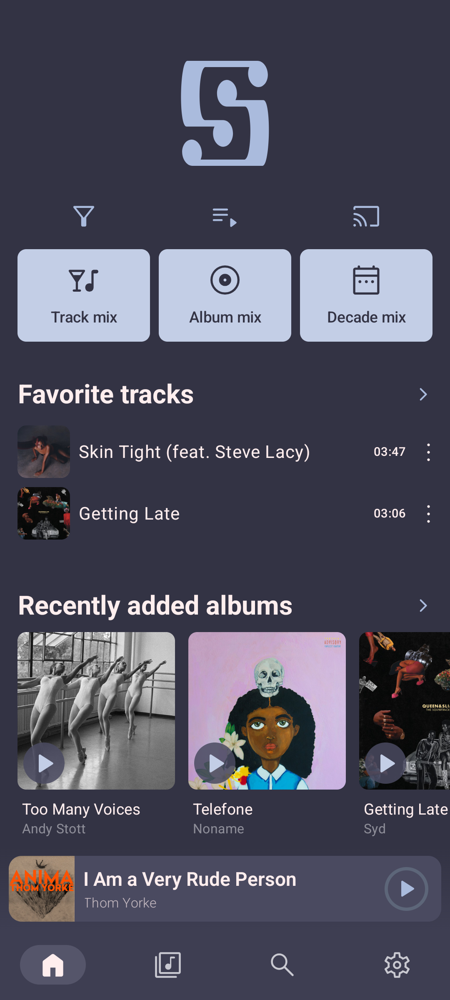
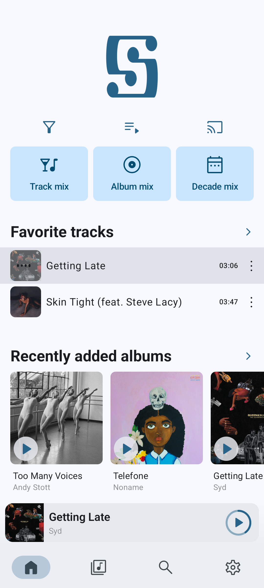

# friedrich

A dual-identity theme for [Symfonium](https://symfonium.app/) (app version > v12): **indigo
night, blue day**. The dark scheme is deep indigo with soft periwinkle accents — quiet,
legible, easy on the eyes at night. The light scheme is a blue Material day scheme with
sea-blue actions, pale sky containers, and a violet tertiary — sharing the night scheme's
blue lineage for continuity across modes. Both live in one file; the app's Theme mode decides
which one you see.

## Import

1. Copy `friedrich.json` to your device.
2. In Symfonium: **Settings → Interface → Theme, font and colors**.
3. Under **Default color source**, select **Custom theme**.
4. In the **Custom theme** section, select **Import** and choose `friedrich.json`.

While evaluating the theme, turn off **Now playing color source** / dynamic artwork colors —
they override theme colors on the playback screen.

## Preview

| Night | Day |
| ----- | --- |
|  |  |

## Palette

### Night (dark scheme)

| Hex | Role in the theme |
| ------- | ----------------- |
| `#2a2a38` | Darkest tier — bottom sheets, deep wells |
| `#333344` | Base surface (background) |
| `#4a4a60` | Raised fills — top bar, dialogs, active row |
| `#55556a` | Subtle fills — dropdowns, snackbars; search bar & selections |
| `#c9c9d1` | Secondary text |
| `#ffeeee` | Primary text |
| `#aabbdd` | Periwinkle — logo, primary actions, active icons, switches, play-overlay icon, separators |
| `#c3cee6` | Periwinkle (pale) — mix cards |
| `#8fb08a` / `#a3c49d` | Sage — tertiary accents, drag-and-drop controls |
| `#c97a7e` / `#d98f92` | Rose — errors and warnings |

### Day (light scheme)

| Hex | Role in the theme |
| ------- | ----------------- |
| `#f7f9ff` | Base surface (background) |
| `#ffffff` → `#f1f4f9` → `#ebeef3` → `#e5e8ed` → `#e0e3e8` | Surface ladder (lowest → highest) |
| `#181c20` / `#41474d` | Primary / secondary text |
| `#72787e` / `#c1c7ce` | Borders / active-row fill |
| `#28638a` | Sea blue — logo, primary actions, play-overlay icon, separators |
| `#cae6ff` | Sky blue — mix cards |
| `#b7c9d9` | Blue (mid) — search bar, selected chips, nav pill |
| `#65587b` / `#ebdcff` | Violet — tertiary accents, drag-and-drop controls |
| `#ba1a1a` / `#ffdad6` | Red — errors and warnings |

### Reserved (unused in both schemes)

| Hex | Family |
| ------- | ------ |
| `#b493b8` / `#c9a9cd` | Mauve |
| `#d0b483` / `#e0c79a` | Gold |
| `#8fb3b3` / `#a3c7c7` | Teal |

## Role mapping

The two schemes share a blue lineage; each role is mapped per scheme.

| Role | Night | Day |
| ---- | ----- | --- |
| `surface` | `#333344` | `#f7f9ff` |
| `surfaceContainerLowest` | `#2a2a38` | `#ffffff` |
| `surfaceContainerLow` | `#333344` | `#f1f4f9` |
| `surfaceContainer` | `#3e3e52` ᵈ | `#ebeef3` |
| `surfaceContainerHigh` | `#4a4a60` | `#e5e8ed` |
| `surfaceContainerHighest` | `#55556a` | `#e0e3e8` |
| `surfaceVariant` | `#4a4a60` | `#dde3ea` |
| `onSurface` | `#ffeeee` | `#181c20` |
| `onSurfaceVariant` | `#c9c9d1` | `#41474d` |
| `outline` | `#83839c` ᵈ | `#72787e` |
| `outlineVariant` | `#4a4a60` | `#c1c7ce` |
| `primary` / `onPrimary` | `#aabbdd` / `#333344` | `#28638a` / `#ffffff` |
| `primaryContainer` / `onPrimaryContainer` | `#c3cee6` / `#333344` | `#cae6ff` / `#004b70` |
| `secondary` / `onSecondary` | `#aabbdd` / `#333344` | `#28638a` / `#ffffff` |
| `secondaryContainer` / `onSecondaryContainer` | `#55556a` / `#ffeeee` | `#b7c9d9` / `#384956` |
| `tertiary` / `onTertiary` | `#8fb08a` / `#333344` | `#65587b` / `#ffffff` |
| `tertiaryContainer` / `onTertiaryContainer` | `#a3c49d` / `#333344` | `#ebdcff` / `#4d4162` |
| `error` / `onError` | `#c97a7e` / `#1c1c28` ᵈ | `#ba1a1a` / `#ffffff` |
| `errorContainer` / `onErrorContainer` | `#d98f92` / `#333344` | `#ffdad6` / `#93000a` |

ᵈ = derived tone in the night scheme; every other value is a palette value as-is. Two notes:
`secondary`/`onSecondary` carry the **logo color** of each scheme (periwinkle at night, sea
blue by day) — the play-overlay triangle always matches the big logo and the mini-player
play button, and stays visible over its scheme's cover scrim. In the day scheme,
`secondaryContainer` additionally sits one step deeper than the standard container tone so the
search bar stays visible against header bands.

## Contrast (WCAG 2.2)

Every text pairing in both schemes passes **AA** (4.5:1) or better; many pass **AAA** (7:1).

| Pairing | Night | Day |
| ------- | ----- | --- |
| `onSurface` / `surface` | 11.02:1 | 16.27:1 |
| `onSurfaceVariant` / `surface` | 7.52:1 | 8.93:1 |
| `onSurface` / `surfaceContainerHighest` | 6.47:1 | 13.32:1 |
| `onPrimary` / `primary` | 6.40:1 | 6.48:1 |
| `onPrimaryContainer` / `primaryContainer` | 7.83:1 | 7.26:1 |
| `onSecondary` / `secondary` | 6.40:1 | 6.48:1 |
| `onSecondaryContainer` / `secondaryContainer` | 6.47:1 | 5.48:1 |
| `onTertiary` / `tertiary` | 5.15:1 | 6.49:1 |
| `onTertiaryContainer` / `tertiaryContainer` | 6.44:1 | 7.21:1 |
| `onError` / `error` | 5.27:1 | 6.46:1 |
| `onErrorContainer` / `errorContainer` | 4.89:1 | 7.24:1 |

Functional borders (`outline`) meet the 3:1 non-text threshold (3.35:1 night, 4.24:1 day).
Deliberate exceptions: night borders on the highest containers sit at 2.0–2.8:1; the
active-row highlight is intentionally quiet in both schemes (1.44 / 1.62:1) — the playing row
is also identified by playback icons, never by color alone.

## Notes

- The file carries both schemes in Symfonium's compact format (27 color roles); the app's
  Theme mode decides which one applies.
- To share on [Symfonium Styles](https://styles.symfonium.app/), first import the theme and
  re-export it from Symfonium — the catalog requires files exported by the app, plus a name,
  description, and at least one screenshot.
